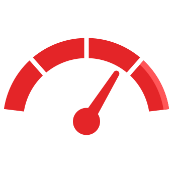

<div align="center">



# QuotaMeter

**One dashboard for all your AI quotas.**<br>
Monitor multiple **Codex**, **Claude**, and **Google AI Pro / Antigravity** accounts
from your terminal or browser.

[](https://github.com/jasonfaeq/QuotaMeter/actions/workflows/ci.yml)
[](https://nodejs.org)
[](package.json)
[](LICENSE)

&nbsp;&nbsp;&nbsp;
&nbsp;&nbsp;&nbsp;


</div>

---

## Highlights

- **Many accounts, one view.** Add as many accounts per provider as you like and
  check them all in a single scan.
- **Live terminal app.** `qm watch` gives you a full-screen view with provider tabs,
  an account sidebar, reset countdowns, and an "upcoming resets" panel.
- **Fits any terminal.** Layouts adapt to the terminal width, from wide monitors
  down to narrow split panes. They handle CJK and emoji widths correctly and work
  without colour.
- **Web dashboard / PWA.** `quotameter-server` serves an installable dashboard
  from the same quota engine.
- **Private by default.** Emails are masked, and snapshots never contain tokens,
  raw provider responses, or file paths.
- **Safe with your other tools.** QuotaMeter only refreshes credentials it enrolled
  itself. Codex CLI, Claude Code, OpenCode, and other tool stores are read-only.
- **Zero runtime dependencies.** Plain Node.js 18+ and ESM.

## Contents

- [Install](#install)
- [Quick start](#quick-start)
- [Watch mode](#watch-mode)
- [Managed accounts](#managed-accounts)
- [Provider configuration](#provider-configuration)
- [Output and privacy](#output-and-privacy)
- [Web dashboard / PWA](#web-dashboard--pwa)
- [Development](#development)

## Install

```sh
npm install -g quotameter
# or
bun add -g quotameter
```

The CLI is installed as both `quotameter` and the short alias **`qm`**.

> Requires Node.js 18 or newer. Optional discovery from SQLite-backed harness
> stores requires a Node version with `node:sqlite`.

## Quick start

```sh
qm codex add personal      # sign in and enroll an account
qm codex add work          # as many accounts per provider as you like
qm claude add main
qm antigravity add gemini

qm                         # one-shot quota view
qm watch                   # live full-screen view
qm codex work              # one provider / account
qm --compact               # one line per metric
qm --json                  # redacted machine-readable snapshot
```

Bare `qm` always runs once. Cards fill the available terminal width. On short
terminals, QuotaMeter tries more, narrower columns first, then falls back to one
aligned line per quota window.

## Watch mode

`qm watch` (aliases: `qm tui`, `qm -w`) opens a full-screen app with:

- **Provider tabs** across the top
- An **account sidebar** showing each account's lowest remaining quota
- A **detail pane** for the selected account, with limits, reset countdowns, and details
- A **status bar**, plus an **upcoming resets** list across all accounts (`u`)

Terminals narrower than 72 columns drop the sidebar. Watch mode uses 24-bit
colour; `--no-color` or `NO_COLOR` renders the same layout without colour.

| Key | Action |
| --- | --- |
| `q`, Ctrl-C | Quit and restore the terminal |
| `r` | Refresh now |
| `u` | Show or hide upcoming resets across all accounts |
| `e` | Toggle email visibility |
| `?` | Toggle help |
| `1` | All providers |
| `2`–`4` | Codex, Claude, Antigravity |
| `j`/`k`, arrows | Select the next/previous account |
| PgUp/PgDn | Jump several accounts |
| `+`/`-` | Increase/decrease the refresh interval by 15 seconds |

The default refresh interval is **3 minutes**; the minimum is 15 seconds. Use
`--once` to force one-shot output. If input or output is redirected, QuotaMeter
falls back to a static view. A failed scan keeps the last completed view and shows
a stale marker. Failures on individual accounts appear on their own cards.

When Anthropic rate-limits quota reads, QuotaMeter waits at least five minutes
(or longer, if the `Retry-After` header asks for it) before the next Claude
request. The card shows the remaining wait.

## Managed accounts

Every provider supports the same commands:

```sh
qm <provider> add [label]        # enroll a new account via OAuth login
qm <provider> reauth <label>     # replace a credential with a fresh login
qm <provider> rename <old> <new>
qm <provider> remove <label>
qm accounts                      # labels and ownership status (never credentials)
qm sources                       # every physical credential source
```

Rename and remove only affect QuotaMeter's own store:

| Provider | Owned store |
| --- | --- |
| `codex` | `~/.codex-accounts.json` |
| `claude` | `~/.claude-accounts.json` |
| `antigravity` | `~/.antigravity-accounts.json` |

Each label must be a different account. `add` refuses a sign-in that matches an
account you already added, so switch accounts in your browser first.

Writes are atomic and use file mode `0600`. Any `activeLabel` metadata is ignored
and removed on the next write. QuotaMeter lists rows it did not enroll itself (for
example, accounts that another tool wrote into these files) as `imported`. They
stay read-only until you run `reauth` for them.

### Credential ownership

QuotaMeter refreshes only the credentials it enrolled itself, and it saves rotated
tokens only in its own stores. It never selects an active identity or writes
credentials into Codex CLI, Claude Code, OpenCode, pi, or other tool stores.

External stores and environment credentials are optional **read-only** quota
sources. QuotaMeter can query them while their access tokens are still valid, but
it never refreshes these external sessions. When one expires, enroll the account
with `qm <provider> add`. `qm sources` lists every physical source, including
duplicates. Quota views deduplicate accounts by identity and prefer managed labels.

<details>
<summary><strong>Single-account providers</strong></summary>

If you have exactly one account for a provider but some sessions lack matching
identity metadata, set `QUOTAMETER_SINGLE_ACCOUNT_PROVIDERS=claude,antigravity` in
`~/.quotameter.env`, listing only the providers where this is true. Quota views
then select one session per listed provider, preferring a managed session or a
valid access token over expired copies. `qm sources` still lists every source.
Remove a provider from this setting when you add a second account.

</details>

## Provider configuration

QuotaMeter can load optional environment settings from `~/.quotameter.env`.
Variables already set in the process environment take precedence. Keep this file
private.

| Provider | Setup |
| --- | --- |
| **Codex / Claude** | Use the built-in provider login flows. Headless login shows a URL, plus callback or code instructions for that provider. |
| **Antigravity** | Set `ANTIGRAVITY_CLIENT_ID` and `ANTIGRAVITY_CLIENT_SECRET` for the installed-app flow (no client secret ships in the package). The loopback redirect uses port `36742`. QuotaMeter reads OpenCode's `antigravity-accounts.json` from its default location, or from `ANTIGRAVITY_OPENCODE_ACCOUNTS_PATH`. |
| **proxx** | Optional read-only Codex quota source, configured with `PROXX_BASE_URL` and `PROXX_AUTH_TOKEN`. Its accounts are merged into Codex; if the remote fails, local results are kept. |

[The OAuth notes](docs/oauth.md) describe the OAuth endpoints and client
assumptions. A successful login does not guarantee that every subscription can
access every provider service.

## Output and privacy

```sh
qm --json                    # redacted snapshot
qm quota work --compact
qm watch --interval 90
qm --show-email              # reveal emails locally
qm --no-color                # NO_COLOR is honored too
```

- Emails are **masked by default**. `--show-email` reveals only the email field in
  local terminal and JSON output. The web API always uses its public, masked
  projection.
- ANSI and control characters in remote display text are sanitized.
- Reset times use your computer's time zone. To override it, set
  `QUOTAMETER_TIME_ZONE` (for example `Europe/Berlin`) in `~/.quotameter.env`.
  Machine-readable timestamps are ISO 8601.

<details>
<summary><strong>Snapshot schema</strong></summary>

Completed snapshots use `schemaVersion: 1`, a `generatedAt` timestamp, and an
ordered `providers` array. Accounts contain a label, an optional email and plan,
a `status` (`ok`, `error`, or `loading`), windows, and optional extras. Each window
has `id`, `label`, `percentRemaining`, `resetsAt`, and an optional `detail`.

Snapshots never contain raw provider responses, tokens, or source paths. Only
`qm sources --json` includes source paths, on purpose.

</details>

## Web dashboard / PWA

```sh
quotameter-server            # production
bun run app                  # development
```

The dashboard runs at **http://127.0.0.1:4789** by default. Configure it with
`QUOTAMETER_HOST`, `QUOTAMETER_PORT`, and `QUOTAMETER_ALLOWED_HOSTS`.

It uses the same in-process quota loader as the CLI, with public (masked) data, a
short cache, and a single shared request when several arrive at once. The host
allowlist, security headers, and static-file path restrictions are always on.
`/api/health` and `/api/quota` return schema version 1.

## Development

```sh
bun test               # full test suite (fixture credentials, mocked HTTP)
bun run preflight      # release checks
bun run release:pack   # dry-run package
```

| Path | Contents |
| --- | --- |
| `quotameter.js` | CLI entry point |
| `quotameter-server.js` | Web dashboard entry point |
| `lib/` | Provider adapters, owned credential store, snapshot pipeline, CLI, server |
| `lib/tui/` | Width-aware layout, rendering, and the watch shell |
| `web/` | Dashboard / PWA assets |
| `test/` | Bun tests that import `lib/` modules directly |
| `docs/` | OAuth and protocol notes |

See [AGENTS.md](AGENTS.md) for architecture, ownership rules, and contribution
guidelines.

## License

MIT © 2026 JasonFaeq. See [LICENSE](LICENSE).
